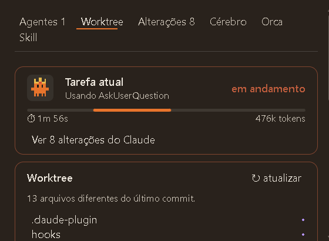
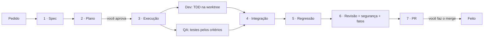
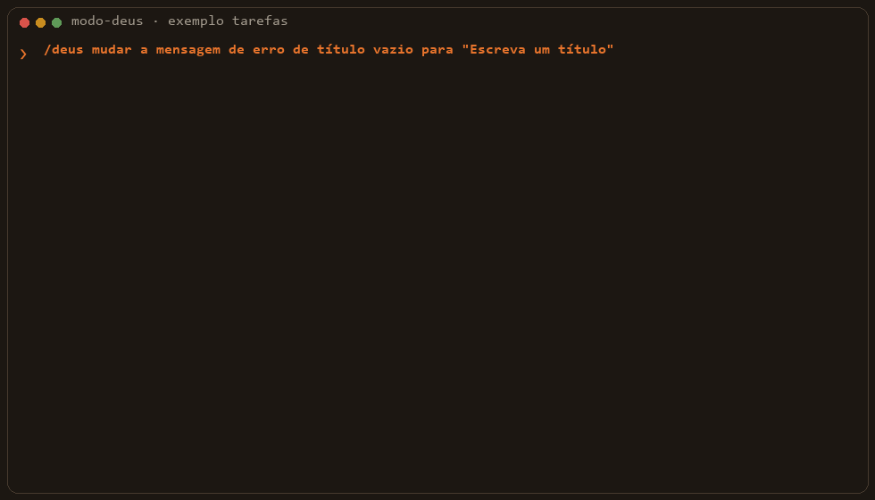

# kit-agentes · modo-deus

[](https://github.com/IcaroMartins07/kit-agentes/actions/workflows/ci.yml) [](LICENSE)  [](https://github.com/IcaroMartins07/kit-agentes/releases)

Um time de agentes para o [Claude Code](https://claude.com/claude-code): um **Maestro** que transforma o pedido em spec e plano, times de **Desenvolvimento**, **QA** e **Revisão** que trabalham em paralelo, cada um no seu território, e **guardrails** que verificam cada passo em vez de só pedir. Junto, mods que deixam a interface do Claude com a cara do kit.



- **Do pedido ao PR com duas paradas:** você aprova o plano e faz o merge. O resto o Maestro decide, registra e segue.
- **Prova antes de "pronto":** hooks recusam entrega sem teste rodado, comando inventado, fuga de escopo e dependência sem auditoria (regras V1 a V12).
- **Padrões do projeto em primeiro lugar:** o instalador lê stack, linter, integrações e comandos do projeto, e todo agente segue isso.
- **Melhora com o uso:** a `/retro` transforma falhas reais em propostas, medidas por avaliações e aplicadas só com o seu sim.

## Como funciona



Uma execução real do `/deus` no [projeto de exemplo](exemplos/tarefas), reproduzida a partir do registro da sessão (spec e plano, Dev e QA em paralelo nas worktrees, testes, revisão):



Pedido pequeno vai pelo **caminho rápido** (uma aprovação, Dev com TDD e revisor). O detalhe de cada passo, de cada agente e de cada skill está em [docs/FLUXO-E-SKILLS.md](docs/FLUXO-E-SKILLS.md).

## Instalar

Requisitos: [Claude Code](https://claude.com/claude-code), Node 18+, git e Python (para o [graphify](https://pypi.org/project/graphifyy/), o mapa do código).

```bash
git clone https://github.com/IcaroMartins07/kit-agentes.git
cd kit-agentes
npm link                       # deixa o comando agents-mode disponível em qualquer pasta
cd /caminho/do/seu/projeto
agents-mode --perfil estrito   # plugin do kit, dependências, kit no projeto e conferência
```

Reinicie o app do Claude depois. Opções do `agents-mode`: `--perfil leve|estrito|deus`, `--times dev-mobile=ligado`, `--statusline`, `--sem-grafo`, `--escopo local|user` (das dependências) e `--dry-run` (só mostra). Pode rodar de novo quando quiser: o que já está instalado é atualizado.

<details>
<summary>Passo a passo, sem o agents-mode</summary>

```bash
claude plugin marketplace add <pasta-do-kit>
claude plugin install modo-deus@kit-agentes --scope user
node <pasta-do-kit>/instalar.mjs dependencias /caminho/do/projeto
node <pasta-do-kit>/instalar.mjs /caminho/do/projeto --perfil estrito
node <pasta-do-kit>/instalar.mjs doctor /caminho/do/projeto
```

Sem clonar, só o plugin: `claude plugin marketplace add IcaroMartins07/kit-agentes` e `claude plugin install modo-deus@kit-agentes --scope user` (a parte por projeto continua precisando do `instalar.mjs`).

Remover de um projeto: `node instalar.mjs --remover /caminho/do/projeto` (o que é seu vai para `~/.claude/modo-deus/backups/`).
</details>

O instalador cria `.modo-deus/` no projeto (`REGRAS.md` com stack, comandos, convenções, integrações e territórios detectados; perfil; telemetria), aplica um deny-list no `.claude/settings.local.json` e monta o mapa do código em `graphify-out/`. Tudo fica fora do git do projeto.

### Perfis

| Perfil | O que vale |
|---|---|
| `leve` | Trava de fase e cerca de segurança. Sem monitor. |
| `estrito` (padrão) | Tudo do leve, mais o monitor V1–V12 em modo alerta. |
| `deus` | Monitor bloqueando, auditor de fatos e PR aberto pelo Maestro. |

## Usar

| Comando | O que faz |
|---|---|
| `/deus <pedido>` | O Maestro leva o pedido da spec ao PR |
| `/spec`, `/plan`, `/build`, `/review`, `/ship` | O mesmo fluxo, passo a passo, conduzido por você |
| `/deus-status` | Tarefas, subagentes, alertas e o painel HTML |
| `/retro` | Melhora o kit a partir das falhas da sessão |
| `/auditar` | Auditoria do repositório, só relatório |

Para a sessão inteira como Maestro: `claude --agent modo-deus:maestro`. Lista completa em [docs/comandos.md](docs/comandos.md).

## Interface

Os mods do kit mudam a cara do Claude Code e entram pelo mesmo marketplace:

```bash
claude plugin install painel-agentes@kit-agentes --scope user   # painel com agentes, worktree, alterações, grafo, Orca e skills
claude plugin install temas@kit-agentes --scope user            # temas e a cena das dunas (/tema)
claude plugin install prompt-master@kit-agentes --scope user    # reescreve o prompt antes de enviar
```

| Dunas de noite (modo escuro) | Dunas de dia (modo claro) |
|---|---|
|  |  |

Detalhes e mods de terceiros em [mods/](mods). O que um mod não alcança: a barra lateral de sessões, o cabeçalho e a caixa do prompt, que são do próprio app.

## Estrutura

| Pasta | O que tem |
|---|---|
| [`agents/`](agents) | Os 16 agentes: Maestro, Dev (7), QA (5) e Revisão (3). Guia: [docs/agentes.md](docs/agentes.md) |
| [`commands/`](commands) | Guia: [docs/comandos.md](docs/comandos.md). Os comandos `/deus`, `/spec`, `/plan`, `/build`, `/review`, `/ship`, `/deus-status`, `/retro`, `/auditar` |
| [`skills/`](skills) | Skills próprias (`modo-deus`, `vigia`, `retrospectiva`, `qa-cypress`) e de terceiros, com origem e commit |
| [`hooks/`](hooks) | Os guardrails (trava, território, cerca, monitor, telemetria, retro), a lista de dependências e as ferramentas (status line, painel do `/deus-status`) |
| [`mods/`](mods) | Mods de interface: `kit/` (do kit) e `terceiros/` |
| [`docs/`](docs) | O fluxo explicado, os modelos de `CLAUDE.md` e `REGRAS.md` e as imagens |
| [`testes/`](testes) | A suíte do kit (`npm test`) e as avaliações das skills |
| [`exemplos/`](exemplos) | Um projeto pequeno para testar o `/deus` de ponta a ponta |

Na raiz: `kit.json` (perfis, agentes, territórios, skills), `instalar.mjs`, `agents-mode.mjs`, o manifesto do plugin em `.claude-plugin/` e o [CHANGELOG](CHANGELOG.md).

## Testes

```bash
npm test
```

Roda em Linux e Windows, node 18 a 22 (CI no GitHub Actions). As avaliações das skills, que usam sessões reais do Claude, estão em [testes/evals](testes/evals).

## Contribuir

Veja [CONTRIBUTING.md](CONTRIBUTING.md). Falhas de segurança: [SECURITY.md](SECURITY.md).

## Licença

[MIT](LICENSE). Componentes de terceiros mantêm as licenças deles: [TERCEIROS.md](TERCEIROS.md).
